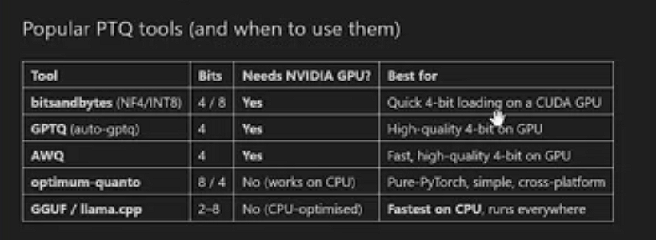

# FORMAT   BITS  BYTES PER WEIGHT TYPICAL USE
# fp32      32        1.0             Traning
# fp36/bf16 16        2.0                GPU inference
# int8       8        1.0                4 * smallar comman use
# int4       4        0.5                   

# Memory Math 
# number of parameters * bytes per parameter

# TOOLS FOR QUANT
# PTQ (PREP BUILD MODEL QUAN) AND QAT (QUANT THROUGH TRAIN METHOD)

